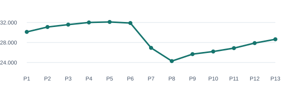

# Retail BI | ¿Qué productos quedaron atrás después de la caída?

Proyecto de portafolio con **SQL (SQLite) y Power BI**, basado en 52 semanas de compras de 811 productos.

## La pregunta de gerencia

**¿Qué productos bajaron en volumen?** Al revisar la serie completa apareció un patrón más amplio: el volumen total pasó de **31.892 unidades en el período 6** a **24.282 en el período 8**, el punto más bajo. Después repuntó hasta **28.645 unidades en el período 13**. Visto en dos tramos de igual duración, las semanas 25 a 48 registraron **30.964 unidades menos (−16,4 %)** que las primeras 24.

*El eje horizontal muestra los períodos 1 a 13, cada uno de cuatro semanas. En los CSV, P6, P8 y P13 son columnas de períodos. En la columna `Product_Code`, P193 significa «Producto 193».*

## Cómo cambió la pregunta

El repunte total llevó a una pregunta más útil para gerencia: **¿qué productos seguían por debajo de su nivel previo a la caída, aun después de que el volumen general empezó a recuperarse?**

Tomé el período 6 como referencia, el 8 como punto más bajo y el 13 como cierre. De los **543 productos** que cayeron entre los períodos 6 y 8:

| Estado al cierre | Productos |
| --- | ---: |
| Recuperaron o superaron su nivel previo | 225 |
| Mejoraron, pero siguieron por debajo | 184 |
| Siguieron en el nivel del período 8 o empeoraron | 134 |

En total, **318 productos** cerraron por debajo de su nivel previo.

## Qué productos revisar primero

La **brecha en unidades** muestra dónde quedó más volumen por recuperar. La **variación porcentual** muestra qué tan grande fue la caída respecto del nivel inicial de cada producto. Ambas comparan el período 13 con el 6.

| Producto | Unidades por recuperar | Variación frente al período 6 |
| --- | ---: | ---: |
| Producto 193 | 66 | −37,3 % |
| Producto 43 | 65 | −34,9 % |
| Producto 135 | 64 | −35,6 % |
| Producto 690 | 3 | −100 % |

Empezaría por los **productos 193, 43 y 135** por su impacto en volumen. Revisaría también casos como el **producto 690**, que pasó de 3 unidades a cero. Su brecha es pequeña en unidades y equivale a toda su base.

## Cómo lo hice

Con SQL convertí las 52 columnas semanales en **42.172 filas producto-semana**, agrupé el volumen en períodos de cuatro semanas y calculé el estado y la brecha de cada producto. En Power BI visualicé la evolución, la recuperación y las prioridades, y verifiqué que los resultados se mantuvieran al actualizar las tres tablas.

[Evolución por período](datos/resumen_periodos.csv) · [Recuperación por producto](datos/recuperacion_productos.csv) · [Ranking completo](datos/ranking_prioridades.csv)

**Fuente de datos** · James Tan (2014), *Sales Transactions Weekly*, UCI Machine Learning Repository. Los CSV contienen agregaciones y cálculos derivados del conjunto original. [Conjunto original](https://doi.org/10.24432/C5XS4Q) · [Licencia CC BY 4.0](https://creativecommons.org/licenses/by/4.0/)
